# Problem 4: Fork Storm Containment & Tiered CPU Scheduling

**Kernel:** Linux 6.8.0-q4lab  
**Testing Environment:** Ubuntu Virtual Machine

## Problem Statement

Modify the Linux kernel to implement a graduated fork-rate containment system and tiered CPU scheduling (GOLD, SILVER, BRONZE), ensuring that scheduling privileges never override fork-containment policies.

---

## Test 1: Baseline

**Test Case (Assignment):** Baseline. Run `taskset -c 0 yes > /dev/null &` as both users and watch `top`. Expect a roughly 50/50 split.

**Objective:** Verify that two CPU-bound processes belonging to different users receive approximately equal CPU time when both have the default SILVER tier.

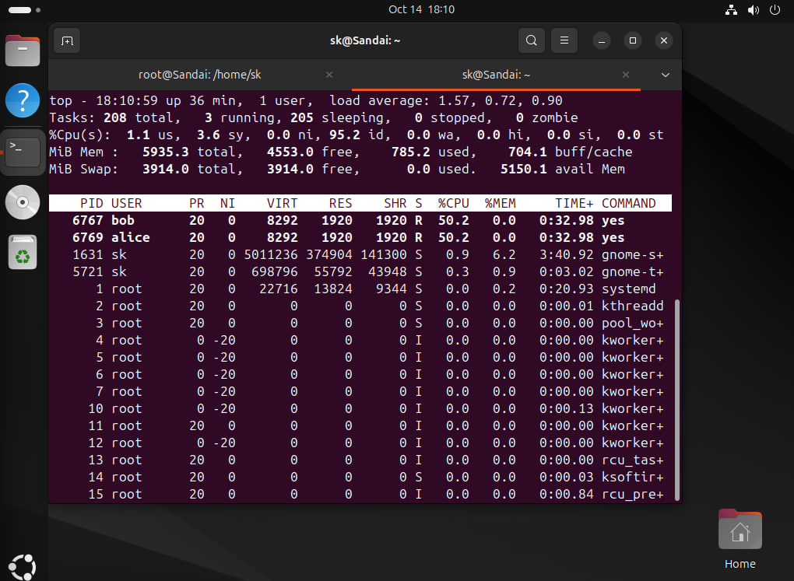

**Observation:** CPU-intensive `yes` processes were launched for both users and restricted to CPU core 0, ensuring that both workloads competed for the same CPU.

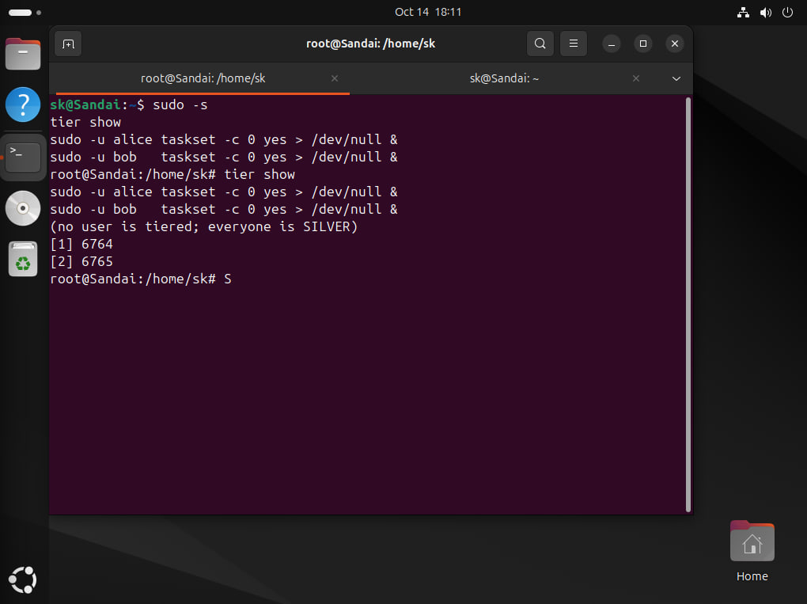

**Observation:** Both processes had nice value `0` (SILVER) and received approximately 50% CPU time each, confirming fair CPU allocation under equal scheduling weights.

---

## Test 2: Promote

**Test Case (Assignment):** Promote. From the root terminal, with both workloads and `top` still running, run `tier set <user> gold`. The promoted user's share must rise without restarting the workload.

**Objective:** Verify that promoting an existing user to GOLD immediately increases their CPU share without requiring the running process to restart.

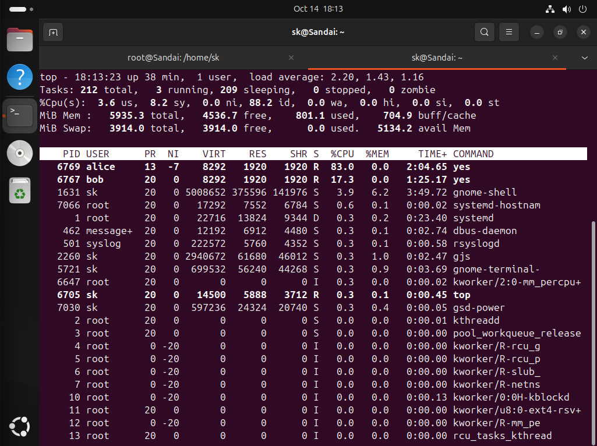

**Observation:** The administrator promoted Alice to GOLD using the `tier set` command while the CPU-intensive workloads were already running.

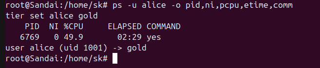

**Observation:** Alice's running process received nice value `-7`, confirming that the tier change was applied to an existing process without restarting it.

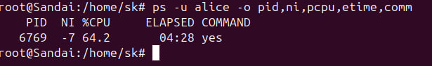

**Observation:** Alice's CPU share increased to approximately 83%, while Bob received approximately 17%, consistent with the scheduling weight difference between GOLD and SILVER.

---

## Test 3: Demote

**Test Case (Assignment):** Demote. Set the other user to bronze. The gap widens. Confirm from `top` that the bronze user still accumulates CPU time — it must not be starved to zero.

**Objective:** Verify that assigning BRONZE to a user reduces their CPU share compared to GOLD, while ensuring that the BRONZE process continues making progress.

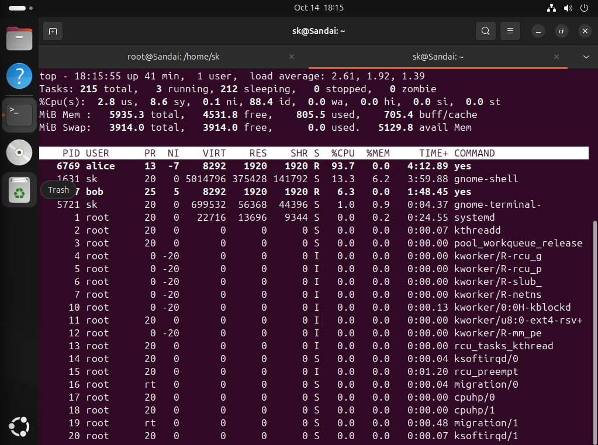

**Observation:** Bob was assigned the BRONZE tier while Alice remained GOLD, increasing the scheduling priority difference between the two users.

**Observation:** Alice's process retained nice value `-7`, while Bob's changed to `+5`. Alice received most of the CPU time, but Bob continued consuming CPU time, confirming that BRONZE was not starved.

---

## Test 4: Reset

**Test Case (Assignment):** Reset. Run `tier reset` and confirm the split returns to roughly 50/50.

**Objective:** Verify that resetting tier assignments restores the default scheduling priorities and approximately equal CPU sharing between users.

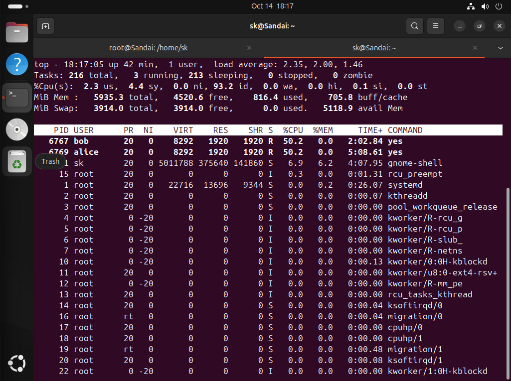

**Observation:** The `tier reset` command cleared the previously assigned GOLD and BRONZE tiers, returning both users to the default SILVER configuration.

**Observation:** Both processes returned to nice value `0`, and their CPU utilization returned to approximately 50% each, confirming successful restoration of equal scheduling weights.

---

## Test 5: Containment, Untiered

**Test Case (Assignment):** Containment, untiered. Run `sudo forkstat` on the root terminal, then launch `:(){ :|:& };:` as the ordinary user. Watch the ladder run: the bomb must stop by itself and the shell must come back.

**Objective:** Verify that the kernel detects excessive process creation by an ordinary user and automatically contains the fork bomb through THROTTLE, FREEZE, and REAP.

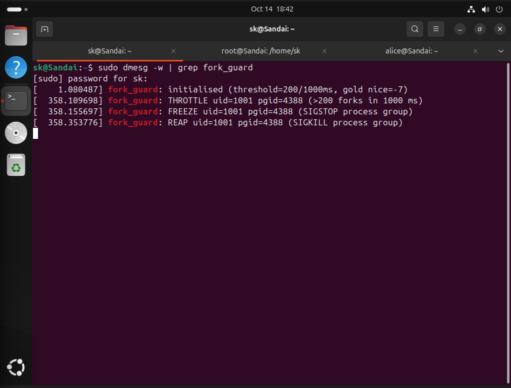

**Observation:** The fork-containment experiment was initiated for an ordinary user, generating rapid process-creation attempts to test the kernel's monitoring mechanism.

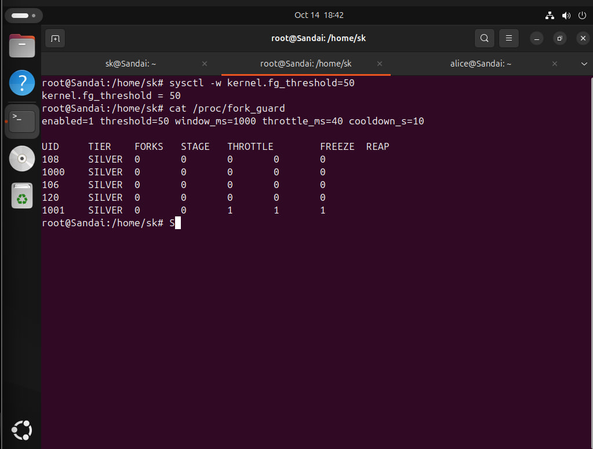

**Observation:** The kernel detected excessive fork attempts and began containment. Fork creation was rejected with `EAGAIN`, producing the `Resource temporarily unavailable` message.

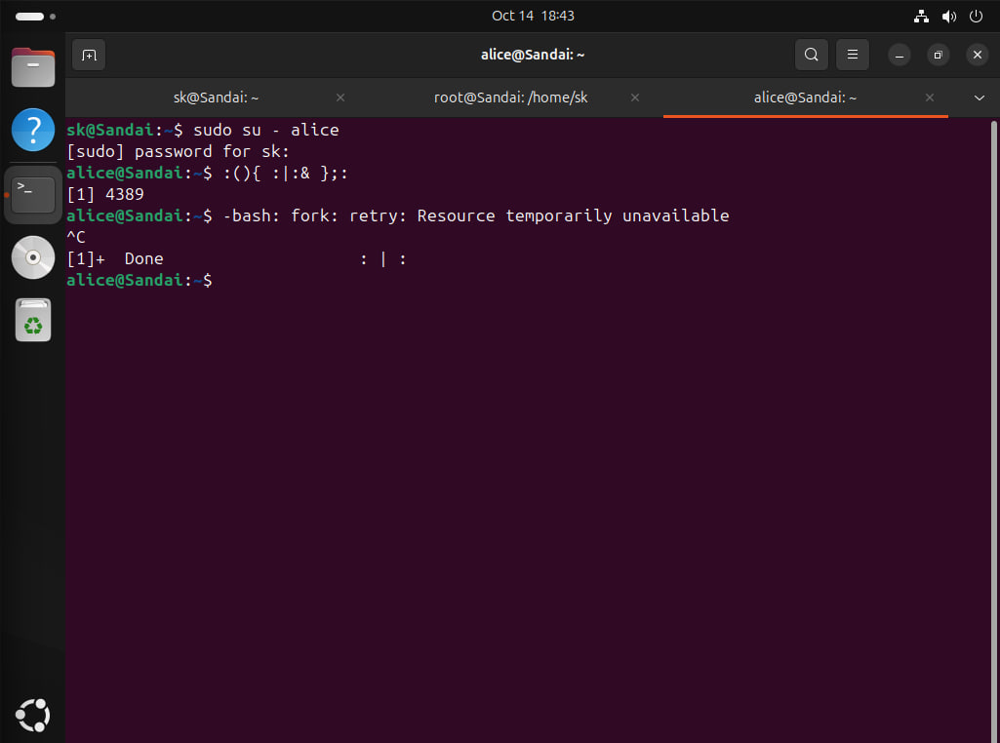

**Observation:** Kernel logs confirmed the complete THROTTLE → FREEZE → REAP sequence. The offending process group was terminated, and the shell prompt returned automatically.

---

## Test 6: Containment, GOLD

**Test Case (Assignment):** Containment, GOLD. Repeat test 5 with the offending user crowned GOLD first. The outcome must be identical.

**Objective:** Verify that GOLD scheduling privileges do not exempt a user from fork-containment restrictions.

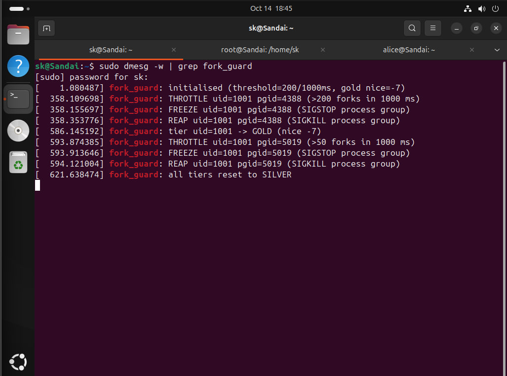

**Observation:** The offending user was promoted to GOLD before initiating the fork-containment experiment, confirming that the test was performed under elevated scheduling privileges.

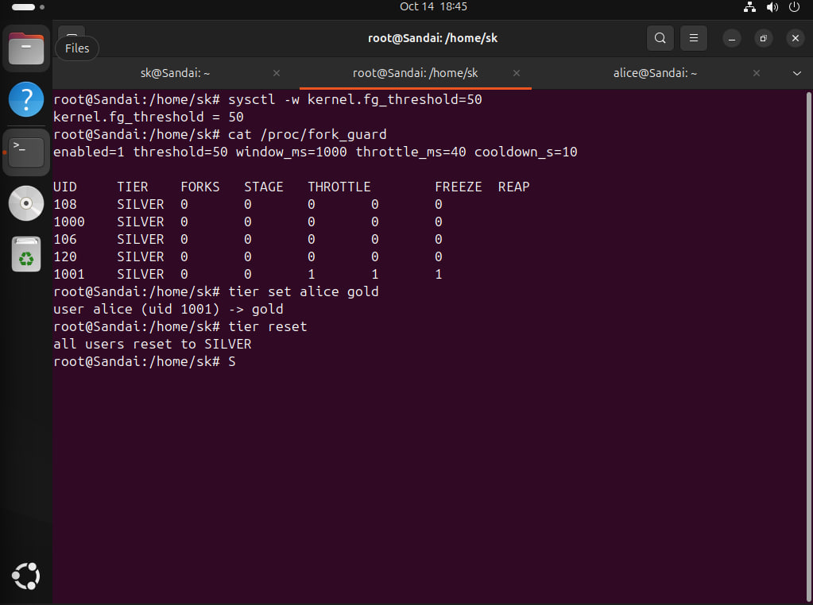

**Observation:** The kernel again executed THROTTLE → FREEZE → REAP, terminating the fork bomb despite the user's GOLD status. This confirmed that scheduling privileges did not override fork-containment protection.

---

## Test 7: Retune at Runtime

**Test Case (Assignment):** Retune at runtime. Lower `fg_threshold` via `sysctl`, repeat test 5, and show that containment triggers sooner — with no kernel rebuild.

**Objective:** Verify that fork-containment parameters can be modified dynamically and that the updated configuration takes effect without recompiling or rebooting the kernel.

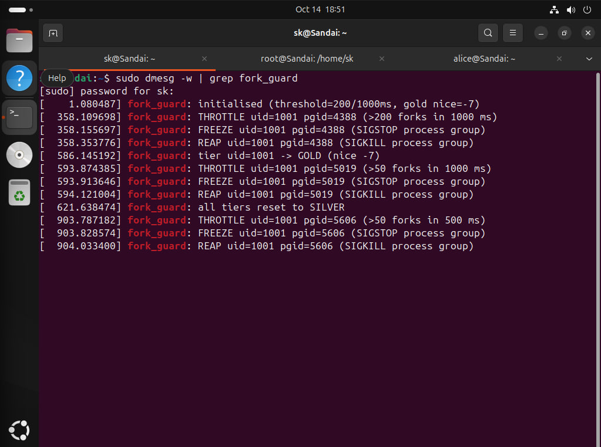

**Observation:** The fork-containment experiment was repeated after reducing the threshold. Kernel logs showed the containment sequence using the updated limit of 50 forks within 500 ms.

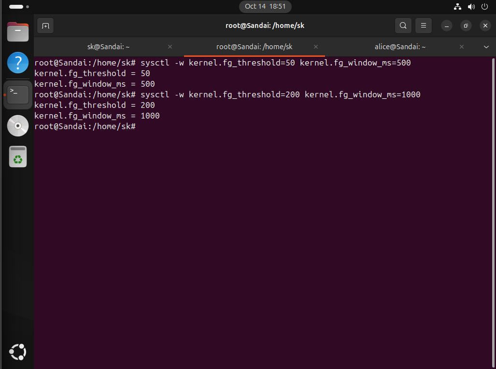

**Observation:** The threshold was changed from `200` to `50` and the monitoring window from `1000 ms` to `500 ms` using `sysctl`. Both parameters were subsequently restored, demonstrating runtime configurability without rebuilding the kernel.

---

## Test 8: Observability

**Test Case (Assignment):** Observability. `cat` your `/proc` stats file and show the escalation counters and tier assignments. Then check `dmesg` for the fork-containment and tier log lines.

**Objective:** Verify that the kernel exposes fork-containment statistics, scheduling tier assignments, runtime configuration, and event logs through the required interfaces.

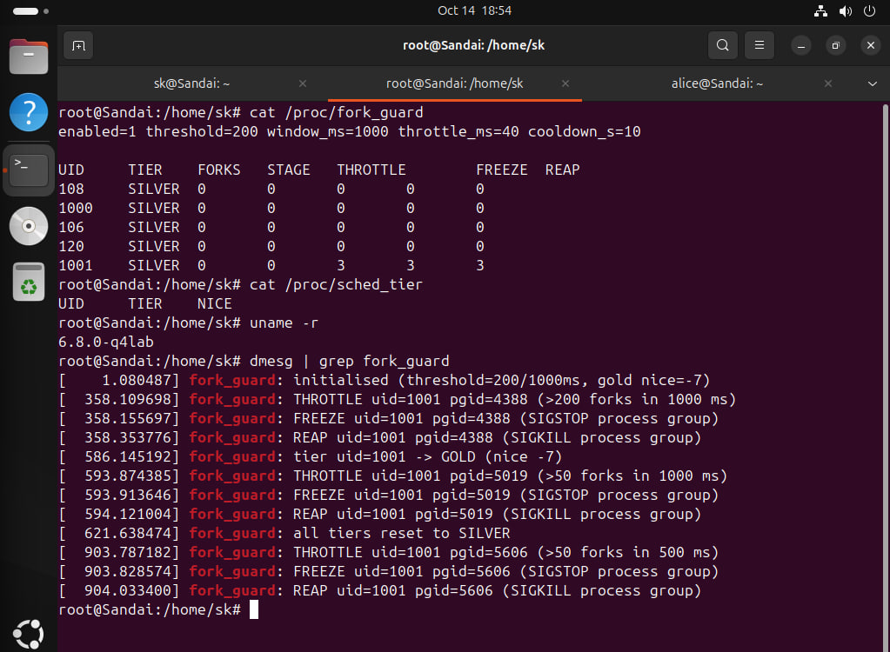

**Observation:** The custom kernel `6.8.0-q4lab` exposed fork-containment statistics through `/proc/fork_guard`, including cumulative THROTTLE, FREEZE, and REAP counters. `/proc/sched_tier` showed no active assignments after reset, while `dmesg` recorded the containment and tier-management events.

---

## Conclusion

All eight tests demonstrated the expected kernel behavior. Tiered scheduling successfully differentiated CPU shares while preserving progress for BRONZE users. Fork containment detected and terminated excessive process creation for both ordinary and GOLD users. Runtime configuration and kernel observability interfaces also functioned as intended.